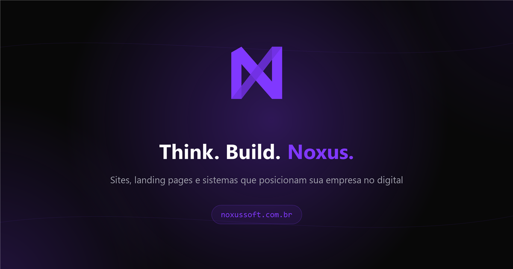

<div align="center">



# NoxusSoft · Site institucional

**Sites, landing pages e sistemas que posicionam sua empresa no digital.**

[](https://noxussoft.com.br)
[](https://www.instagram.com/noxussoft/)

</div>

---

## 💡 Sobre o projeto

Landing page institucional da **NoxusSoft**, empresa de desenvolvimento web de Londrina-PR.
Feita em **HTML, CSS e JavaScript puro**, sem framework e sem etapa de build, com foco em
performance, animações fluidas e experiência no celular.

> Este repositório é a versão estática da landing. O site em produção roda em uma aplicação
> Next.js, que também hospeda sistemas internos e por isso é privada.

## ✨ Destaques

- **Intro animada** com a marca e transição para o conteúdo
- **Hero com vídeo** e pôster otimizado para carregar rápido
- **Esteira horizontal de projetos** com sites reais de clientes
- **Configurador de orçamento** que monta a mensagem e abre o WhatsApp já preenchido
- **Animações de entrada** (reveal) ao rolar a página
- **Responsivo**, com menu mobile próprio
- **SEO e compartilhamento**: metatags, Open Graph e `robots.txt`

## 🛠️ Tecnologias


## 🚀 Rodar localmente

```bash
npx serve -l 4173 .
```

Depois acesse `http://localhost:4173`.

## 📁 Estrutura

| Arquivo | Conteúdo |
|---|---|
| `index.html` | Landing page completa |
| `styles.css` | Estilos e sistema visual da marca |
| `main.js` | Intro, reveals, esteira de projetos e configurador |
| `assets/` | Imagens, vídeo do hero e imagens de compartilhamento |

---

<div align="center">

Desenvolvido por **[Heitor Perdigão](https://github.com/heitorperdigao)** · NoxusSoft

</div>
